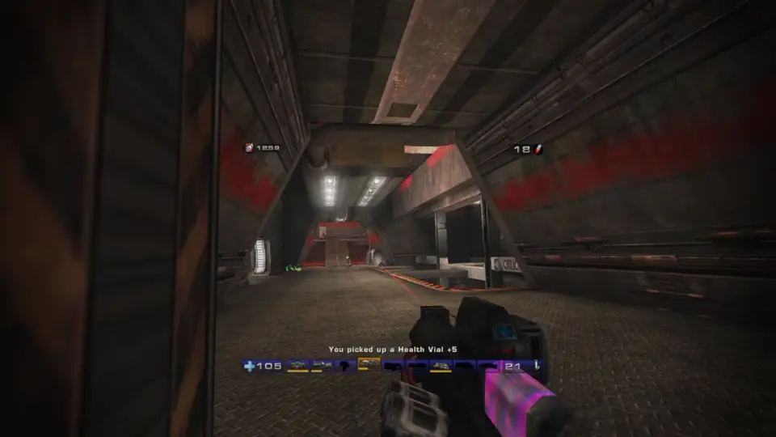
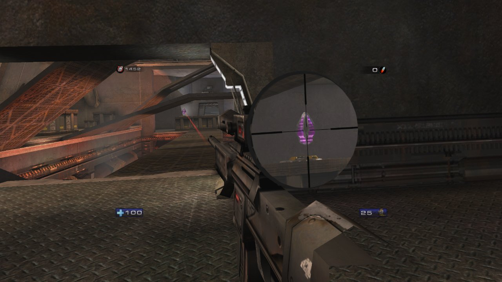
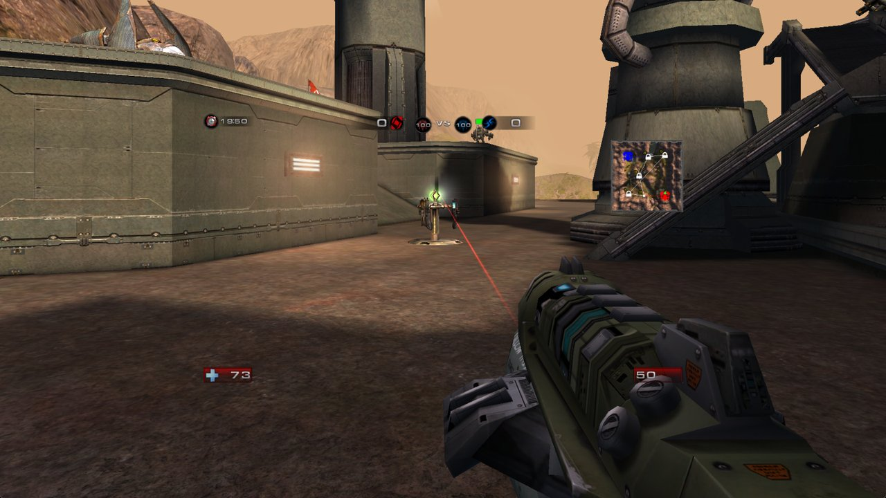
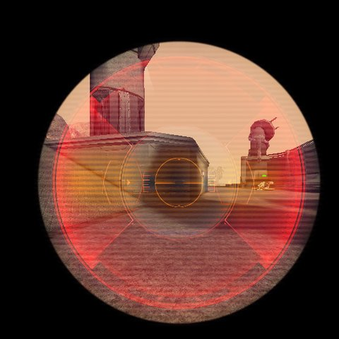
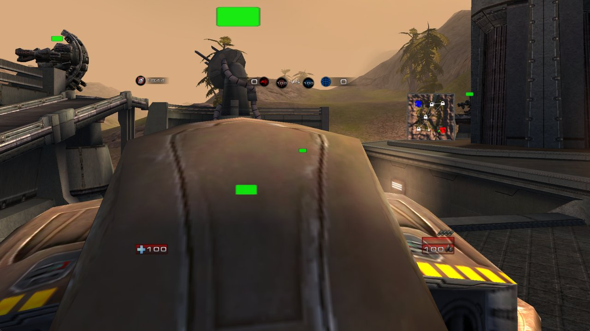

# UT2004VR

**Unreal Tournament 2004 in virtual reality.** Play UT2004 in a SteamVR headset with Half-Life: Alyx-style
controls: the gun in your hand, aimed by pointing, a true stereo view of the arenas, and the game's own HUD and
menus floating in front of you.

Real play in the headset, recorded from the desktop mirror (one eye).

## Features

- **The gun is in your hand.** Point the controller to aim; shots, beams and projectiles leave the muzzle. An
  aiming laser, recoil, and no aim assist.
- **True stereo, head-tracked.** Both eyes are rendered by the game at your head position; walk around your room
  with collision, or play seated.
- **Smooth locomotion, snap or smooth turn, teleport**, and a comfort vignette.
- **Any game type against bots** (Deathmatch, Onslaught, Assault, Single Player...), started from UT2004's own
  menus, which float in front of you.
- **Vehicles and turrets** aimed with your controller, including Assault's space fighters.
- **Zoom in a scope lens** on the gun, and the **guided Redeemer** seen through a window at the warhead's tip.
- **The game type's own HUD**, scoreboard and messages, with Assault's objective markers placed in 3D.
- **Left-handed mode** and a **keyboard-and-mouse mode** (the headset still looks around).
- Starting UT2004 the normal way still gives you the plain, flat game.

| | |
|---|---|
|  |  |
| **Scope lens.** Zoom shows in a lens on the gun, not across your whole view. | **Every weapon in hand**, here the Redeemer in Onslaught. |
|  |  |
| **Guided Redeemer.** You ride the warhead, looking out through its window. | **Vehicles.** You sit in them; the right controller aims. |

These four from the desktop mirror (one eye), with the mod's simulated headset.

## Requirements

- **Unreal Tournament 2004 with OldUnreal's patch 3374, 64-bit, Preview 23 or newer.** OldUnreal's
  [installer](https://www.oldunreal.com) sets up the game with the latest patch; to update an existing install, get
  the [patch](https://github.com/OldUnreal/UT2004Patches/releases). Tested on Release Candidate 3.
- **SteamVR** and a headset with motion controllers. Default bindings are included for Quest/Touch, Valve Index,
  HTC Vive and Windows Mixed Reality (HP Reverb).
- **Windows 10 or 11.**

## Install

1. Download `UT2004VR-<version>.zip` from the [latest release](https://github.com/jmkokko/ut2004-vr/releases/latest)
   and unzip it anywhere.
2. Run **`Install.bat`**. It finds your UT2004 folder (or asks for it), checks the game version, copies the mod into
   the game's `System` folder and offers a desktop shortcut.

That's all: nothing outside the game's `System` folder changes. To remove the mod, run
`System\UT2004VR-Uninstall.bat`.

Installing by hand

Copy the contents of the zip's `System` folder into your UT2004's `System` folder. If a `d3d9.dll` from another
tool (ReShade, dgVoodoo) is already there, keep a copy of it: UT2004VR needs that file name.

## Getting started

1. Start **SteamVR** with the headset and controllers on.
2. Run the **UT2004 VR** shortcut (or `System\Play-VR.bat`). The intro plays around you, then the main menu
   appears in front of you.
3. Point the right controller at the menu and pull the trigger to click. Choose **Instant Action**, a game type and
   a map, and start.
4. Pull the trigger to join the match.

Tips:
- **Hold the left Y button (0.8 s) to recenter** your height and facing, for example after sitting down.
- You can play seated or standing: your eyes are placed at a UT player's eye height either way
  (`bMatchGameHeight=False` uses your real height instead).
- `Play-VR.bat DM-Antalus` (any map name) skips the menus and starts a deathmatch with bots.
- VR settings are kept apart from your normal ones, in `UT2004VR_Game.ini`. It is made from your `UT2004.ini` on
  the first run; delete it to start again from your current settings.

## Controls

These are the default SteamVR bindings (Touch and Reverb shown). You can change them in SteamVR's
**Controller Bindings** while the game runs.

**On foot**

| Control | Action |
|---|---|
| Left stick | Move. Looking to the side while moving turns you that way. |
| Right stick left / right | Snap turn (45°) |
| Right stick forward | Aim the teleport arc; release to teleport |
| Right stick back (hold) | Crouch (crouching for real works too) |
| Right stick click | Use: get in or out of a vehicle or turret |
| Right trigger | Fire (also: respawn, click in menus) |
| Right grip | Alt-fire |
| A / B | Next / previous weapon |
| Left grip | Jump |
| Left trigger + left stick | Dodge in that direction |
| Left Y | Menu. **Hold: recenter** |
| Left X | Scoreboard |
| Trigger / grip while spectating | Next player / back to your own view |

**In vehicles and turrets**

| Control | Action |
|---|---|
| Left stick | Drive and steer (hovering and flying vehicles strafe) |
| Right controller | Aim: the crosshair is where it points. The Manta, Raptor and Cicada turn toward it. |
| Right trigger / grip | Fire / alt-fire |
| Left grip, left trigger / right stick back | Jump or rise / duck or descend |
| A / B | Next / previous seat |
| Left stick click | Horn |

**In Assault's space fighters**

| Control | Action |
|---|---|
| Right controller | Aim; the ship turns toward the crosshair and banks into the turn |
| Left stick | Throttle and strafe |
| Left trigger + left stick left / right | Roll; the left grip levels the wings |
| A / B | Next / previous target |

**Other controllers**

| Controller | Differences |
|---|---|
| Valve Index | Left B: menu. Left A: scoreboard. |
| Windows Mixed Reality | Left menu button: menu. Left touchpad click: scoreboard. Right touchpad: next weapon; right menu button: previous weapon. |
| HTC Vive | No scoreboard button. |

## Options

**Left-handed.** Settings > Player > **Weapon Hand: Left** puts the gun in your left hand and mirrors every control.

**Keyboard and mouse.** Type `VRKeyboard` in the console (the `~` key) to switch. UT's own keys and mouse play the
game while the headset looks around freely. The gun sits in front of you; Weapon Hand places it right, left, in the
middle, or hides it. `VRKeyboard` again switches back.

**Comfort and fit** (console commands, saved):

| Command | What it does |
|---|---|
| `VRSnap 30` | Snap turn angle; `VRSnap 0` turns smoothly |
| `VRSpeed 0.7` | Walking speed, as a share of UT's |
| `VRHeight 10` | Raise your eyes by 10 units (about 19 cm); negative lowers them |
| `VRGrip -4 0 2` | Move the gun in your hand: forward, right, up (units of about 2 cm). Per weapon. |
| `VRGripReset` | Back to the default grip for this weapon |

Every setting is listed in [the configuration reference](docs/CONFIGURATION.md).

## More about the features

<b>Weapons, laser and recoil</b>

Each gun is the weapon's full model, held by its handle. A faint red laser runs from the muzzle to what you're
aiming at; it hides while you fire. Shots kick the gun back and up, then it settles. Turn any of these down in
[the configuration](docs/CONFIGURATION.md#weapons-laser-and-recoil); `bWeapons=False` is a walk-only mode.

<b>Zoom and scope</b>

Zooming (Lightning Gun, Sniper Rifle) doesn't magnify your whole view, which is uncomfortable in a headset.
Instead a round lens on the gun shows the zoomed picture with a reticle: raise the gun to your eye. While zoomed,
the right stick forward and back zooms further in and out. Move the lens for the weapon in your hand with
`VRScope <forward> <right> <up>` (metres).

<b>Guided Redeemer</b>

Alt-fire launches the warhead and you ride it, looking out through a round window at its tip with UT's scope
markings. Steer with the right stick (or the mouse); fire detonates it.

<b>Vehicles, turrets and gunner seats</b>

You sit in the vehicle's own seat, with your head tracked. The right controller aims every vehicle and turret:
guns turn to where it points, and the vehicles that face their aim (Manta, Raptor, Cicada) turn toward it. On
turrets and gunner seats, aiming near the edge of your view slowly turns the seat that way. Behind view (`F` on the
keyboard) gives a chase camera. Adjust your seat in a vehicle with `VRSeat <forward> <right> <up>`, and
`VRSeatMesh` shows or hides the vehicle's model around you.

<b>HUD, scoreboard and menus</b>

The headset shows the game type's own HUD: Onslaught's radar and node row, Assault's timers and objectives, the
usual health and ammo. Assault's objective markers are drawn on the objectives themselves.
The scoreboard replaces the HUD while it's up. Menus float in front of you as a curved panel that stays put in the
room; point and click with the right controller.

<b>Intro, Single Player and online</b>

UT2004's startup intro plays around you in 3D (the trigger skips it). Single Player matches start in VR too.
Joining an online server isn't supported in VR: you get the game on a big flat screen in front of you, played with
keyboard and mouse.

## Troubleshooting

| Problem | Try |
|---|---|
| Nothing appears in the headset | Start SteamVR before the game, and launch with the **UT2004 VR** shortcut or `Play-VR.bat`. |
| Facing the wrong way, or the floor is at the wrong height | Hold the left Y button for a second to recenter. |
| Low frame rate | Lower `RenderScale` in `System\UT2004VR_proxy.ini` (for example to 0.7). |
| Controls don't match this page | In SteamVR's Controller Bindings, pick the default binding for UT2004VR. |
| SteamVR crashes when the controllers wake up (WMR) | A driver issue: turn the controllers on before starting the game. |
| Antivirus warns about `d3d9.dll` | It's the mod's unsigned bridge to SteamVR; the source is in this repository. |
| Start the VR settings over | Delete `System\UT2004VR_Game.ini` and `System\UT2004VR.ini`. |

**Known limits:** VR is for offline play against bots; online servers run without VR. Onslaught's node health bars,
CTF flags and Assault's info pods aren't shown in 3D yet.

## Building from source

The mod is an UnrealScript package plus a small `d3d9.dll` that hands the eye images to SteamVR.
[docs/DEVELOPMENT.md](docs/DEVELOPMENT.md) covers how it works, building, testing with the simulated headset,
recording and making a release. The development journal is [MODLOG.md](MODLOG.md).

## Credits and license

- [OldUnreal](https://www.oldunreal.com) keeps UT2004 running on modern systems with patch 3374.
- [OpenVR](https://github.com/ValveSoftware/openvr) © Valve (BSD 3-clause).
- Built with AI assistance (Claude Code and the [universal-modder](https://github.com/rehan-remade/universal-modder)
  toolkit).

UT2004VR is released under the [MIT license](LICENSE). Unreal Tournament 2004 belongs to Epic Games; no game files
are included, so you need your own copy.
